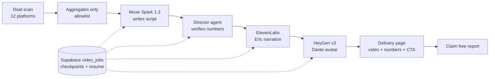

# Rankall video reports — Meta Global AI Developer Hackathon entry

A business scans its AI visibility on Rankall, and gets back a **personalized
video report** — a presenter who tells that business, from its own
real scan numbers, where AI recommends it and where competitors are taking
its customers. Then one click claims the full written report.

## Try it (no login)

- **Judge demos** — pick a business, watch its video in under 30 seconds:
  https://rankall-git-hackathon-video-report-nandish-patel-s-projects.vercel.app/hackathon/video-report/judge
- **Live front door** — run a fresh scan and watch a video generate:
  https://rankall-git-hackathon-video-report-nandish-patel-s-projects.vercel.app/hackathon/video-report
- **Demo video (screen walkthrough v3, 2:17, founder-approved Oct 27)** — https://rankall-git-hackathon-video-report-nandish-patel-s-projects.vercel.app/demo-walkthrough-v3.mp4 (front door, fresh scan, real video-report clip, director + Meta beats, business-page segment labeled pre-existing).
- **Submission docs** — development plan, technical plan, test plan, and test scenarios: [docs/dev-plan.md](docs/dev-plan.md), [docs/technical-plan.md](docs/technical-plan.md), [docs/test-plan.md](docs/test-plan.md), [docs/test-scenarios.md](docs/test-scenarios.md).

Every demo video on the judge page is labeled with its real run date as a
**previously completed real run** — never presented as freshly generated.

## What was built during the hackathon (Oct 26 – Nov 4, 2026)

New in-window work — this is the submission:

- **Video pipeline** — scan aggregates → script → director verification →
  narration → avatar render → delivery page, with a durable job store and
  checkpoint/resume so a 60-second serverless limit never loses a render.
- **Meta AI as the 12th scanned platform**, live by default, via Meta's Model
  API (Muse Spark 1.3). New scans run 12 platforms; pre-Meta demos keep
  their original platform count (the Oct 8 Folsom demo shows 7 of 11,
  with no Meta line — nothing backfilled).
- **Agentic director** — an agent layer inside the pipeline that reviews its
  own draft against the real scan JSON, rejects weak hooks and overclaims,
  and repairs them before rendering.
- **Judge Mode** — 11 pre-scanned real businesses with instantly playing
  videos, plus a visible Meta chain and on-page director report.
- **Delivery page + jobs dashboard + self-serve front door** (Business /
  Person toggle, one shared scan pipeline).
- **Bounded cross-invocation script retries** — when Spark returns empty
  content, the job stays processing and a later poll retries Spark (max 3
  attempts total) instead of falling back immediately. Proven live Oct 28:
  two empties, then a Spark script on the third attempt.

## Pre-existing (NOT hackathon work)

The scan engine, platform scoring, reports, dashboards, and business pages
existed before Oct 26 and are shown only as context. The business page
appears solely as a labeled secondary link ("this page already existed —
the video is what's new"). No new business-page building happened during
the window.

## Product identification — prototype (in-window design note)

Muse (Meta AI) doesn't just recommend businesses — it identifies
products. The prototype asks, in plain words: does it identify YOUR
product correctly, misidentify it, or substitute a competitor's product —
and does it appear in an ad or an organic recommendation? Ads and organic
are never mixed. How the check works, in plain words: the seller's own
feed/catalog comes first; the Meta Model API prototype is labeled as an
API model, not consumer Muse; an official catalog is used where one
applies. Future coverage is per-platform — Amazon, Shopify, eBay,
Marketplace, TikTok, Walmart, and others — but full cross-platform
tracking is post-Nov 4 build-phase work, not a submission claim. A
surface with no permitted method yet is labeled "pending", never scored,
and no product data is invented. The Judge Mode page carries a short
labeled prototype note (Product-tier pipeline proof: Dyson); the demo
hero stays the low scorer. Pre-existing vs in-window split stays
explicit: scan engine = pre-existing, video pipeline + this prototype
note = in-window.

## Architecture

A job checkpoints after every stage (input, script, director, narration
asset, render-start, render-complete). A later poll resumes from the last
checkpoint; a render id is only re-polled, never re-started; a stall past
10 minutes with no progress fails honestly with the failed stage.

## Honesty layer (what the video will never do)

- Scripts use **aggregates only** — the allowlist drops raw AI response text
  entirely, even nested. NULLs stay null, never backfilled.
- The director checks every number in the script against the scan JSON and
  rejects "zero referrals" / "hundreds" class overclaims and weak hooks.
- When Spark returns no usable script, the video uses a **flagged
  rule-based fallback** — flagged on the page, not hidden.
- A platform that fails a scan is recorded as missing, never zero.
- No mock data anywhere in demo content. Test fixtures are labeled.

## The 12 platforms, all 8 tiers

Platforms: ChatGPT, Gemini, Google AI, Copilot, Perplexity, Grok, Claude,
DeepSeek, Mistral, Kimi, Groq, Meta AI (12th, new in-window).

Tiers: Local, Personal, Product, Agency, Enterprise, Government, SEO,
Global Brand Intelligence. The front door and dashboard are tier-agnostic;
the Day 6 batch covers at least one video per tier.

## Measured numbers (no estimates presented as measurements)

- HeyGen v3 render: **~$2.02–2.13 per ~55s video (~$0.038–0.039/s)**,
  measured on real renders — above the <$1/video target; cost capture
  records real wallet-before/after spend per job, so the guard sees real
  numbers. The <$1 target is not met on v3; no cheaper figure is claimed.
- Full server-side video, wall time: 483s (first complete run),
  401s (script-fix re-test). HeyGen render time dominates.
- Day 6 batch: 8 videos, one per tier, $10.40 total (~$1.30/video
  average). All 8 used the flagged fallback (Spark empty on all 8) —
  that batch ran before the bounded retry existed.
- Retry proof (Oct 28): two Spark empties, third attempt landed a Spark
  script; job complete in 401s, $2.17.

## Open gaps (disclosed honestly)

- **Mistral**: RESOLVED Oct 27 — the weeks-long 429 was Free-plan exhaustion, not code. Account upgraded to Pro, key rotated, and the preview gate scan of Oct 27 20:59 CDT (scanId `8d85ebea-9c97-4100-aa26-a98f026c611b`) mentioned 12/12 platforms with Mistral AND Kimi both succeeding. No code fix is claimed for an account limit; the account fix is what closed the gate.
- **Kimi**: fixed in-window — empty-content retries escalate the token
  budget 300 → 1000 (reasoning is ~1,500 characters); verified live.
- **Demo video**: screen walkthrough v3, 2:17, founder-approved Oct 27; https://rankall-git-hackathon-video-report-nandish-patel-s-projects.vercel.app/demo-walkthrough-v3.mp4.

## Run it locally

Standard Next.js commands (`npm install`, `npm run dev`) with these
environment variables set: `MODEL_API_KEY` (Meta Model API),
`HEYGEN_API_KEY`, `ELEVENLABS_API_KEY`, Supabase URL + anon +
service-role keys, and `HACKATHON_VIDEO_REPORT_ENABLED=1`. No secrets are
committed to this repo.

## Team

- Representative: Nandish (founder, Rankall.io)
- Contributors: Nandish (founder, Representative) and Paras Pipalia — no other contributors.

## Attribution

Built with Meta's Model API (Muse Spark), HeyGen, and ElevenLabs (licensed
account). Open-source licenses are noted in the public repo. AI-assisted
build is disclosed; every demo number comes from a real scan.
